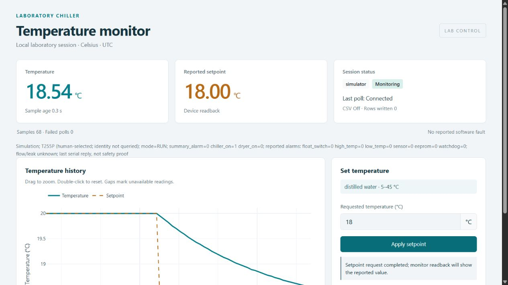

# TarkChiller

A Python controller for **ThermoTek T255P** chillers and **CAL 3300/9300**
controllers. Read temperature and setpoint, change targets, and optionally record
CSV or display a dashboard. The public class is `TarkChiller`.

Both protocols have automated software tests. Limited T255P bench evidence from
21 October 2026 includes 120 production monitoring polls with no errors; CAL
hardware and the new API/dashboard mode controls remain unverified on equipment.
See the [validation scope](docs/protocol.md#bench-evidence-and-limits).
Confirm your unit, wiring, serial settings and coolant limits before connecting.
T255P connection takes serial control and can change AUTO START to RUN.

## Install

Requires Python **3.12+**. This checkout uses [uv](https://docs.astral.sh/uv/)
for dependency and environment management, with Python **3.12** selected by
`.python-version`. [Install uv](https://docs.astral.sh/uv/getting-started/installation/),
then run from the repository root:

```sh
uv sync --locked
uv run --locked python -m tark_chiller.simulator --headless --duration 5
```

uv creates `.venv`, installs the package in editable mode and includes development
tools by default. No environment activation is needed with `uv run`.

Choose the environment you need:

| Use | Install or update environment |
| --- | --- |
| Core driver only | `uv sync --locked --no-dev` |
| Development and tests | `uv sync --locked` |
| Development with dashboard | `uv sync --locked --extra gui` |
| Development with dashboard and notebooks | `uv sync --locked --extra gui --group notebooks` |

Use the same `--no-dev`, `--extra gui` and `--group notebooks` options with
`uv run` for that workflow. `--locked` refuses dependency changes that require a
lockfile update. See [examples](examples/README.md#environment) for notebook kernel
setup and hardware scripts.

### Install into another application

For installation into another application's Python environment:

```sh
python -m pip install .
```

Or install directly from the repository (requires Git and repository access):

```sh
python -m pip install "git+https://github.com/cct1123/tark-mrc-chiller-control.git"
```

Serial support is included. For the optional dashboard, install `".[gui]"` from
this checkout, or `"tark-mrc-chiller[gui] @ git+https://github.com/cct1123/tark-mrc-chiller-control.git"`.
You can also install a built wheel with `python -m pip install path/to/package.whl`.
Use the Python API directly from your own application.

The source has three Python modules:

| Module | Responsibility |
| --- | --- |
| `tark_chiller.controller` | CAL/T255P protocols, serial settings, device ownership, monitoring and CSV |
| `tark_chiller.gui` | Optional dashboard consuming controller snapshots |
| `tark_chiller.simulator` | Thermal model, memory protocol endpoints and simulator launcher |

Version 0.7 uses explicit module imports and has no compatibility aliases.
`TarkChiller(settings, protocol=...)` owns pyserial, monitoring and recording.
Settings, status, samples and snapshots are plain dictionaries; returned settings
and snapshots are detached copies. Simulators provide `.chiller()` to construct
the same controller with a memory endpoint. Reinstall after upgrading and use the
API shown below.

<a id="hardware-quick-start"></a>

## ThermoTek T255P

Use the actual RS-232 port and verified adapter RTS/DTR levels in place of the
example values below. T255P requires 9600 baud, 8N1 and XON/XOFF. Connect only to a
prepared, filled system: the startup U exchange can start an AUTO START unit.

```python
from tark_chiller.controller import TarkChiller, T255P

settings = {
    "port": "COM5",
    "baudrate": 9600,
    "bytesize": 8,
    "parity": "N",
    "stopbits": 1,
    "xonxoff": True,
    "rtscts": False,
    "dsrdtr": False,
    "rts": False,
    "dtr": False,
}
with TarkChiller(
    settings,
    protocol=T255P(),
    setpoint_range=(5.0, 45.0),
    coolant_source="ThermoTek T255P Rev C pp9/20; distilled water",
) as chiller:
    print(chiller.read_temperature())  # Celsius
    print(chiller.read_setpoint())
    print(chiller.read_status())
```

`T255P()` disables target and mode writes. After checking the setup and operating limits,
use `T255P(allow_writes=True)` and call `chiller.set_setpoint(target_c)` inside the
context. `chiller.run()` starts circulation and temperature regulation together
at the existing target; `chiller.standby()` stops both. Both verify the G echo
and U mode/chiller-on readback, and require `allow_writes=True`. RUN requires
clear reported alarms; STANDBY permits alarms. Monitoring can continue in either mode.
Water targets are limited to **5–45 °C in 0.1 °C steps**.
Sensor selection and sub-zero writes are not exposed. A successful target readback
does not mean the liquid has reached that temperature.

Normal one-second monitoring supplies watchdog traffic. There is no hidden
keepalive worker. After more than ten seconds without valid traffic, the unit can
return to local control; the next API operation sends U again to reacquire it.

## CAL 3300/9300

Match the actual controller address, baud rate, parity and adapter line levels.
The following values illustrate a 9600/8N1 unit at address 1; they are not discovery
results. The driver verifies supported identity codes, RTD input and Celsius.

```python
from tark_chiller.controller import TarkChiller, Cal33xx

settings = {
    "port": "COM5",
    "baudrate": 9600,
    "bytesize": 8,
    "parity": "N",
    "stopbits": 1,
    "xonxoff": False,
    "rtscts": False,
    "dsrdtr": False,
    "rts": False,
    "dtr": False,
}
with TarkChiller(settings, protocol=Cal33xx(address=1)) as chiller:
    print(chiller.read_temperature())
    print(chiller.read_setpoint())
    print(chiller.read_status())  # Includes model/firmware codes
```

For writes, construct `Cal33xx(address=1, allow_writes=True,
expected_model=..., expected_firmware=...)` using the actual read codes. The
default water profile is **2–40 °C**. CAL writes lock the keypad, stage the target,
then save/restart the controller and check readback. See the
[hardware guide](docs/hardware.md) before enabling them.

## Recording and dashboard

Inside either controller context, use `chiller.start_monitoring(
csv_path="temperature.csv")`. Read `chiller.snapshot()` for bounded history,
latest readings, sample counts and errors. Call `chiller.stop_monitoring()` to
close the CSV and stop acquisition while keeping synchronous access available.
Existing CSV files are refused. Failed samples carry an error and disconnected
status; unavailable fields are blank. A failed T255P poll can retain a validated
temperature from its final attempt as historical data.
See the [API reference](docs/api.md#monitoring) for a complete recording example.

<a id="optional-dashboard"></a>

With the GUI extra installed, pass a configured controller to
`tark_chiller.gui.run_dashboard(chiller, allow_setpoints=False)`. Open
<http://127.0.0.1:8056>, press **Connect**, then **Start monitoring**.
The same button switches to **Stop monitoring**, which closes recording while
keeping the connection open.
For a write-enabled T255P, the **RUN** and **STANDBY** buttons control the pump
and temperature regulation together. These are independent of monitoring.
Mode changes follow `allow_setpoints` unless `allow_mode_changes` is supplied
explicitly; the protocol must also have `allow_writes=True`.
**Shutdown GUI** stops acquisition, releases the port and closes the server;
Ctrl+C also cleans up. These actions do not command the chiller/pump into standby.
Browser refresh or closure leaves acquisition running. Embedded hosts can use
`create_app(chiller)` and provide an `on_shutdown` hook to enable GUI shutdown.



*Simulator screenshot of the earlier layout; no physical measurement. The current
dashboard also includes session and RUN/STANDBY controls described above.*

## Simulation

These commands use memory-only protocol endpoints and never open a hardware port:

```sh
uv run --locked python -m tark_chiller.simulator --t255p --headless --duration 5 --csv demo.csv
uv run --locked python -m tark_chiller.simulator --cal --headless --duration 5
```

For the optional dashboard, add `--extra gui` after `--locked` and omit `--headless`.
For example:

```sh
uv run --locked --extra gui tark-chiller --t255p
```

Omitting both protocol flags selects the T255P simulator.
`tark-chiller` is the console entry point for `python -m tark_chiller.simulator`.
For Python use, import `CalSimulator` or `T255PSimulator` from
`tark_chiller.simulator` and call `.chiller()` to create a disconnected
`TarkChiller` with a memory-only serial factory. Optional controller arguments
such as `timeout_s` and `reconnect_attempts` can be passed to `.chiller()`.
Simulated dynamics do not predict physical cooling.

## Hardware use and recovery

Use one owning process per device. Construction opens nothing; context entry
connects and context exit stops monitoring, closes CSV and disconnects.
Shutdown lock waits and worker joining share one timeout budget, default five
seconds: `disconnect(timeout_s=...)` or `stop_monitoring(timeout_s=...)`. A timeout
can leave resources owned; let pending I/O finish and retry cleanup. A failed
CSV close also retains its handle for another cleanup attempt. Port and CSV close
are synchronous and can outlast the budget. Contexts preserve an existing exception
and attach cleanup failures as notes. [Shutdown details](docs/api.md#shutdown-and-cleanup).

**Disconnecting software does not stop the chiller or pump.** Follow the equipment
shutdown procedure separately.

Writes are never retried. An uncertain write closes and latches the controller;
inspect the actual panel/target before starting a new read-only session or
considering a corrective target. Alarm flags do not establish flow, leak freedom,
coolant suitability or calibration. Read the [setup and first-use checklist](docs/hardware.md),
[protocol sources and limits](docs/protocol.md), and [API reference](docs/api.md).

Read recovery is disabled by default. With `reconnect_attempts` enabled, I/O
failures, checksum-valid T255P error 1/2 replies and command-echo mismatches can
restart a read with a fresh connection and handshake. Monitoring records an
exhausted retry budget as a failed poll and tries again next interval; fatal
protocol faults stop monitoring. The dashboard example enables two retries.
See [recovery details](docs/api.md#targets-and-recovery) before enabling it.

The [seven hardware examples](examples/README.md), available as scripts with
six standalone notebooks, teach discovering ports,
connecting, reading status, setting one target, recording CSV, measuring connection
timing, requesting RUN/STANDBY and opening a dashboard. Each script and notebook contains
its own explicit T255P connection code; review its `PORT` and operation options
before running. The mode example uses pyserial directly. The dashboard
runs only as a script. Direct API use remains independent.

After configuring the port and preparing the hardware, run a script from the
repository root, for example:

```sh
uv run --locked python examples/01_read_status.py
uv run --locked --extra gui python examples/06_dashboard.py
```

## Development

New maintainers: start with the [development guide](docs/development.md) for the
code map, concurrency rules and a workflow using memory-only tests.

```sh
uv sync --locked --extra gui
uv run --locked --extra gui pytest -q -p no:cacheprovider
uv run --locked --extra gui ruff check src examples tests
uv run --locked --extra gui ruff format --check src examples tests
uv run --locked --extra gui mypy
uv pip check
uv build
```

Tests use memory transports, including error, cancellation, shutdown, recovery
and no-write-replay paths for both protocols. The editable installation also lets
subprocess tests import the package outside the checkout. For release validation,
use `uv sync --locked --extra gui --no-editable --reinstall-package tark-mrc-chiller`,
then `uv run --no-sync pytest -q -p no:cacheprovider`; repeat that sync after source
edits to rebuild the installed package.

### Dependency management

`pyproject.toml` declares dependencies; `uv.lock` records resolved versions.
Commit both files together when changing dependencies. `.python-version` selects
the checkout's interpreter; the package still supports Python 3.12+.

| Task | Command |
| --- | --- |
| Add a runtime dependency | `uv add PACKAGE` |
| Add a development tool | `uv add --group dev PACKAGE` |
| Add a notebook tool | `uv add --group notebooks PACKAGE` |
| Add a dashboard dependency | `uv add --optional gui PACKAGE` |
| Remove a development tool | `uv remove --group dev PACKAGE` |
| Upgrade one locked package | `uv lock --upgrade-package PACKAGE` |
| Check lockfile consistency | `uv lock --check` |

For other removals, use `uv remove` with the same group or extra options used to
add the dependency. After changing dependencies, run `uv sync --locked --extra gui`
and the development checks above. Add `--group notebooks` when checking notebook
tools. Let uv generate `uv.lock`.

`requirements-tested.txt` is a pip-compatible export of the GUI/development
environment. Regenerate it after updating the lockfile and passing the checks:

```sh
uv export --locked --extra gui --no-emit-project --no-hashes --output-file requirements-tested.txt
```
