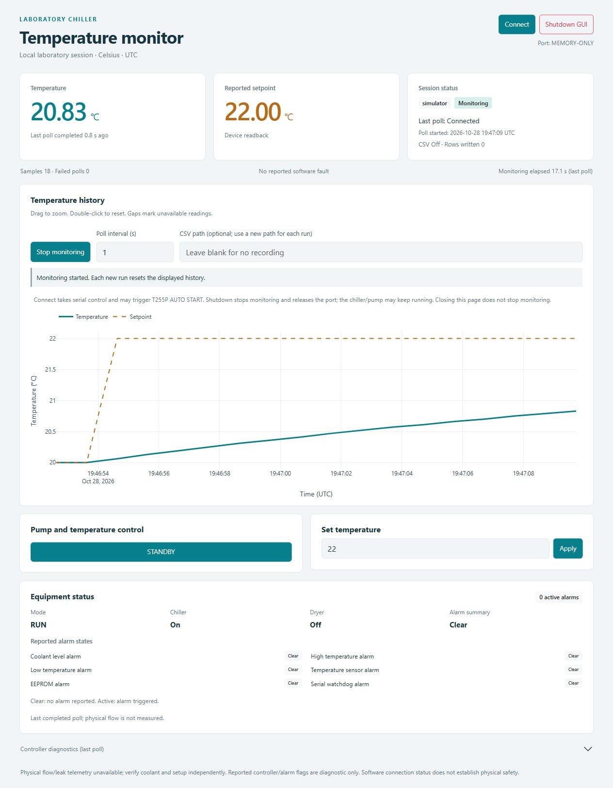

# TarkChiller

A Python controller for **ThermoTek T255P** chillers and **CAL 3300/9300**
controllers. Read temperature and setpoint, change targets, and optionally record
CSV or display a dashboard. The public class is `TarkChiller`.

Both protocols have automated software tests. Limited T255P bench evidence from
21 October 2026 includes 120 production monitoring polls with no errors; CAL
hardware and the new API/dashboard mode controls remain unverified on equipment.
See the [validation scope](docs/protocol.md#bench-evidence-and-limits).
Confirm your unit, wiring, serial settings and coolant limits before connecting.
T255P connection takes serial control and can change AUTO START to RUN.

| Start here | Guide |
| --- | --- |
| Try the driver without equipment | [Simulation](#simulation) |
| Prepare a hardware connection | [Setup and first-use checklist](docs/hardware.md) |
| Use readings, recording and controls | [API reference](docs/api.md) |
| Make your first code change | [Beginner development guide](docs/development.md) |

## Install

Requires Python **3.12+**. This checkout uses [uv](https://docs.astral.sh/uv/)
for dependency and environment management, with Python **3.12** selected by
`.python-version`. [Install uv](https://docs.astral.sh/uv/getting-started/installation/),
then run from the repository root:

```sh
uv sync
uv run tark-chiller --headless --duration 5
```

uv creates `.venv`, installs the package in editable mode and includes development
tools by default. `uv run` also syncs automatically, so the separate `uv sync`
step is optional. No environment activation is needed.

Choose the environment you need:

| Use | Install or update environment |
| --- | --- |
| Core driver only | `uv sync --no-dev` |
| Development and tests | `uv sync` |
| Development with dashboard | `uv sync --extra gui` |
| Development with dashboard and notebooks | `uv sync --extra gui --group notebooks` |

Use the same `--no-dev`, `--extra gui` and `--group notebooks` options with
`uv run` for that workflow. uv uses the committed lockfile and updates it when
dependency declarations change; add `--locked` in CI or when you need to refuse
lockfile changes. See [examples](examples/README.md#environment) for notebook
kernel setup and hardware scripts.

### Install into another application

From another uv project's root, add this checkout by path:

```sh
uv add /path/to/tark-mrc-chiller-control
```

Or install directly from the repository (requires Git and repository access):

```sh
uv add git+https://github.com/cct1123/tark-mrc-chiller-control.git
```

Serial support is included. Add `--extra gui` to either command for the optional
dashboard. You can also add a built wheel with `uv add /path/to/package.whl`.
Use the Python API directly from your own application.

Version 0.7 uses explicit module imports: `TarkChiller` comes from
`tark_chiller.controller`; `T255P`, `Cal33xx` and `ProtocolError` come from
`tark_chiller.protocols`.
`TarkChiller(settings, protocol=...)` owns pyserial, monitoring and recording.
Settings, status, samples and snapshots are plain dictionaries; returned settings
and snapshots are detached copies. Simulators provide `.chiller()` to construct
the same controller with a memory endpoint. Reinstall after upgrading and use the
API shown below. When updating existing callers, replace `read_status()` with
`collect_status()`, `run()` / `standby()` with `set_mode("RUN")` /
`set_mode("STANDBY")`, and verified `set_setpoint()` calls with
`apply_setpoint()`. The T255P-only `set_setpoint()` now checks one M
acknowledgement; it does not read the target back. See the
[migration notes](docs/api.md#updating-existing-callers).

<a id="hardware-quick-start"></a>

## ThermoTek T255P

Use the actual RS-232 port and verified adapter RTS/DTR levels in place of the
example values below. T255P requires 9600 baud, 8N1 and XON/XOFF. Connect only to a
prepared, filled system: the startup U exchange can start an AUTO START unit.

```python
from tark_chiller.controller import TarkChiller
from tark_chiller.protocols import T255P

settings = {
    "port": "COM5",
    "baudrate": 9600,
    "bytesize": 8,
    "parity": "N",
    "stopbits": 1,
    "xonxoff": True,
    "rtscts": False,
    "dsrdtr": False,
    "rts": False,
    "dtr": False,
}
with TarkChiller(
    settings,
    protocol=T255P(),
    setpoint_range=(5.0, 45.0),
    coolant_source="ThermoTek T255P Rev C pp9/20; distilled water",
) as chiller:
    print(chiller.read_temperature())  # Celsius
    print(chiller.read_setpoint())
    print(chiller.collect_status())
```

`T255P()` disables target, mode and sensor-selection writes. After checking the setup and operating limits,
use `T255P(allow_writes=True)` and call `chiller.apply_setpoint(target_c)` inside the
context. `chiller.set_mode("RUN")` starts circulation and temperature regulation together
at the existing target; `chiller.set_mode("STANDBY")` stops both. Both check U
first and skip G if the requested operation is already satisfied; otherwise they
verify the G echo and U readback. The returned status includes `mode_command_sent`.
Both require `allow_writes=True`. Alarm flags remain
visible diagnostics and do not veto target or mode requests. Targets can be changed
in standby. Monitoring can continue in either mode.
Water targets are limited to **5–45 °C in 0.1 °C steps**.
`set_sensor_mode("INTERNAL")` / `set_sensor_mode("EXTERNAL")` selects the sensor;
only the acknowledgement echo can be checked because no sensor-mode query is documented.
Sub-zero target writes remain unsupported. A successful target readback
does not mean the liquid has reached that temperature.

The T255P API uses `get_` / `set_` names. Getters and target/sensor setters send
one command, without handshake, retry or independent readback. For example,
`get_temperature()` sends I, `get_alarms()` sends J, `get_memory()` sends H0,
`get_status()` sends U and `set_setpoint()` sends M. `set_mode()` owns the full
RUN/STANDBY request: U check, conditional G, then U readback after a change.
`get_status()` returns structured mode/on/summary fields; `get_alarms()` returns
six named boolean flags. Explicit `collect_status()` combines U/J, while
`read_temperature()`, `apply_setpoint()` and `set_mode()` perform the checked
workflows used above. CAL uses those workflows. See the
[command API and workflow contracts](docs/api.md#t255p-command-api).

Normal one-second monitoring supplies watchdog traffic. There is no hidden
keepalive worker. After more than ten seconds without valid traffic, the unit can
return to local control. Checked workflows send U again; single-command callers
must explicitly renew the session with `get_status()`.

## CAL 3300/9300

Match the actual controller address, baud rate, parity and adapter line levels.
The following values illustrate a 9600/8N1 unit at address 1; they are not discovery
results. The driver verifies supported identity codes, RTD input and Celsius.

```python
from tark_chiller.controller import TarkChiller
from tark_chiller.protocols import Cal33xx

settings = {
    "port": "COM5",
    "baudrate": 9600,
    "bytesize": 8,
    "parity": "N",
    "stopbits": 1,
    "xonxoff": False,
    "rtscts": False,
    "dsrdtr": False,
    "rts": False,
    "dtr": False,
}
with TarkChiller(settings, protocol=Cal33xx(address=1)) as chiller:
    print(chiller.read_temperature())
    print(chiller.read_setpoint())
    print(chiller.collect_status())  # Includes model/firmware codes
```

For writes, construct `Cal33xx(address=1, allow_writes=True,
expected_model=..., expected_firmware=...)` using the actual read codes. The
default water profile is **2–40 °C**. CAL writes lock the keypad, stage the target,
then save/restart the controller and check readback. See the
[hardware guide](docs/hardware.md) before enabling them.

## Recording and dashboard

Inside either controller context, use `chiller.start_monitoring(
csv_path="temperature.csv")`. Read `chiller.snapshot()` for bounded history,
latest readings, sample counts and errors. Call `chiller.stop_monitoring()` to
close the CSV and stop acquisition while keeping synchronous access available.
Existing CSV files are refused. Failed samples carry an error and disconnected
status; unavailable fields are blank. A failed T255P poll can retain a validated
temperature from its final attempt as historical data.
See the [API reference](docs/api.md#monitoring) for a complete recording example.

`chiller.running` reports whether the **monitoring thread** is alive, including
pending shutdown or cleanup. `chiller.set_mode("RUN")` requests **equipment RUN**. These
are separate states: monitoring can continue in STANDBY, and equipment can remain
in RUN after monitoring stops or the software disconnects.

<a id="optional-dashboard"></a>

With the GUI extra installed, pass a configured controller to
`tark_chiller.gui.run_dashboard(chiller, allow_setpoints=False)`. Open
<http://127.0.0.1:8056>, press **Connect**, then **Start monitoring**.
The same button switches to **Stop monitoring**, which closes recording while
keeping the connection open.
The display shows the poll's UTC timestamp, elapsed monitoring time, structured
equipment state and six alarm flags with an active count. Expand **Controller
diagnostics (last poll)** for details; the panel stays open during refreshes.
Connect and Shutdown GUI are at the top right. Monitoring start/stop, poll interval
and CSV path sit inside the full-width history figure panel. Mode and temperature
controls sit below the figure, stacking vertically on smaller screens.
Equipment status appears beneath the controls. Alarm states are **Clear** when
no alarm is reported and **Active** when triggered; missing readings are **Unavailable**.
For a write-enabled T255P, one mode button shows **STANDBY** when the chiller is
on and **RUN** when it is off. Fresh monitoring data is required to enable it.
This controls the pump and temperature regulation together, independently of monitoring.
Mode changes follow `allow_setpoints` unless `allow_mode_changes` is supplied
explicitly; the protocol must also have `allow_writes=True`.
**Shutdown GUI** stops acquisition, releases the port and closes the server;
Ctrl+C also cleans up. These actions do not command the chiller/pump into standby.
Browser refresh or closure leaves acquisition running. Embedded hosts can use
`create_app(chiller)` and provide an `on_shutdown` hook to enable GUI shutdown.



*Current dashboard with poll timing, structured equipment status and six alarm flags.
Simulator data only; no physical measurement.*

## Simulation

These commands use memory-only protocol endpoints and never open a hardware port:

```sh
uv run tark-chiller --headless --duration 5 --csv demo.csv
uv run tark-chiller --cal --headless --duration 5
```

For the optional dashboard:

```sh
uv run --extra gui tark-chiller
```

Omitting both protocol flags selects the T255P simulator.
`tark-chiller` is the console entry point for `python -m tark_chiller.simulator`.
For Python use, import `CalSimulator` or `T255PSimulator` from
`tark_chiller.simulator` and call `.chiller()` to create a disconnected
`TarkChiller` with a memory-only serial factory. Optional controller arguments
such as `timeout_s` and `reconnect_attempts` can be passed to `.chiller()`.
Simulator controllers enable writes by default for exercises; pass
`allow_writes=False` for a read-only session:

```python
from tark_chiller.simulator import T255PSimulator

with T255PSimulator().chiller(allow_writes=False) as chiller:
    print(chiller.read_temperature())  # 20.0
    print(chiller.collect_status()["backend"])  # simulator
```

An injected simulator clock changes modeled temperature/watchdog time; serial
timeout waits still use real time. Simulated dynamics do not predict physical
cooling. The [first development exercise](docs/development.md#first-exercise-read-a-simulated-temperature)
adds a focused parser test to this workflow.

## Hardware use and recovery

Use one owning process per device. Construction opens nothing; context entry
connects and context exit stops monitoring, closes CSV and disconnects.
Shutdown lock waits and worker joining share one timeout budget, default five
seconds: `disconnect(timeout_s=...)` or `stop_monitoring(timeout_s=...)`. A timeout
can leave resources owned; let pending I/O finish and retry cleanup. A failed
CSV close also retains its handle for another cleanup attempt. Port and CSV close
are synchronous and can outlast the budget. Contexts preserve an existing exception
and attach cleanup failures as notes. [Shutdown details](docs/api.md#shutdown-and-cleanup).

**Disconnecting software does not stop the chiller or pump.** Follow the equipment
shutdown procedure separately.

Writes are never retried. An uncertain write closes and latches the controller;
inspection or reconnect does not clear that latch in the existing object. Follow
the hardware recovery procedure before starting a fresh read-only session or
considering a corrective target. A new object never authorizes replaying an
uncertain write. Alarm flags do not establish flow, leak freedom,
coolant suitability or calibration. Read the [setup and first-use checklist](docs/hardware.md),
[protocol sources and limits](docs/protocol.md), and [API reference](docs/api.md).

Read recovery is disabled by default. With `reconnect_attempts` enabled, I/O
failures, checksum-valid T255P error 1/2 replies and command-echo mismatches can
restart a read with a fresh connection and handshake. Monitoring records an
exhausted retry budget as a failed poll and tries again next interval; fatal
protocol faults stop monitoring. The dashboard example enables two retries.
See [recovery details](docs/api.md#targets-and-recovery) before enabling it.

The [eight hardware examples](examples/README.md), available as scripts with
seven standalone notebooks, teach discovering ports,
connecting, reading status, setting one target, recording CSV, measuring connection
timing, requesting RUN/STANDBY, live console monitoring and opening a dashboard. Each script and notebook contains
its own explicit T255P connection code; review its `PORT` and operation options
before running. The mode example uses pyserial directly. The dashboard
runs only as a script. Direct API use remains independent.

After configuring the port and preparing the hardware, run a script from the
repository root, for example:

```sh
uv run examples/01_read_status.py
uv run --extra gui examples/07_dashboard.py
```

## Development

New maintainers: start with the [development guide](docs/development.md) for the
simulator exercise, a read-path walkthrough, concurrency rules and test choices.

The source separates device ownership, wire protocols and presentation:

| Module | Responsibility |
| --- | --- |
| `tark_chiller.controller` | `TarkChiller`, serial ownership, read recovery, monitoring and CSV |
| `tark_chiller.protocols` | `T255P`, `Cal33xx`, `ProtocolError`, frame codecs and command workflows |
| `tark_chiller.gui` | Dashboard lifecycle, callbacks and explicit session actions |
| `tark_chiller._views` | Private snapshot rendering and controls layout |
| `tark_chiller.simulator` | Thermal model, memory protocol endpoints and simulator launcher |

Private `TypedDict` definitions describe status, samples, snapshots and readings
from one attempt. Values remain ordinary dictionaries. A failed T255P poll may retain
validated readings from its final attempt, with an error and disconnected status;
retries discard the previous attempt's fields. See the
[attempt-reading contract](docs/development.md#readings-from-a-failed-attempt).

Full development checks:

```sh
uv sync --extra gui
uv run --extra gui pytest -q -p no:cacheprovider
uv run ruff check src examples tests
uv run ruff format --check src examples tests
uv run mypy
uv pip check
uv build
```

API, GUI, CSV and snapshot integration tests use the memory serial endpoints and
production protocol code. Focused fakes remain for scheduling, interrupted cleanup
and invalid internal return values. Tests cover errors, cancellation, shutdown,
recovery and no-write-replay paths for both protocols. See
[choosing a test endpoint](docs/development.md#choosing-a-test-endpoint) before
adding a fixture. The editable installation also lets
subprocess tests import the package outside the checkout. For release validation,
use `uv sync --locked --extra gui --no-editable --reinstall-package tark-mrc-chiller`,
then `uv run --no-sync pytest -q -p no:cacheprovider`; repeat that sync after source
edits to rebuild the installed package.

### Dependency management

`pyproject.toml` declares dependencies; `uv.lock` records resolved versions.
Commit both files together when changing dependencies. `.python-version` selects
the checkout's interpreter; the package still supports Python 3.12+.

| Task | Command |
| --- | --- |
| Add a runtime dependency | `uv add PACKAGE` |
| Add a development tool | `uv add --dev PACKAGE` |
| Add a notebook tool | `uv add --group notebooks PACKAGE` |
| Add a dashboard dependency | `uv add --optional gui PACKAGE` |
| Remove a development tool | `uv remove --dev PACKAGE` |
| Upgrade one locked package | `uv lock --upgrade-package PACKAGE` |
| Check lockfile consistency | `uv lock --check` |

For other removals, use `uv remove` with the same group or extra options used to
add the dependency. After changing dependencies, run `uv sync --extra gui`
and the development checks above. Add `--group notebooks` when checking notebook
tools. Let uv generate `uv.lock`.

`requirements-tested.txt` is a pip-compatible export of the GUI/development
environment. Regenerate it after updating the lockfile and passing the checks:

```sh
uv export --locked --extra gui --no-emit-project --no-hashes --output-file requirements-tested.txt
```
