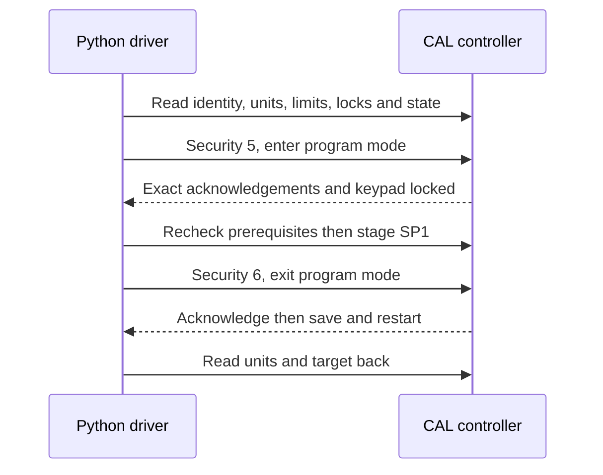

# CAL and T255P protocols: evidence and implemented subsets

[Hardware tutorial](hardware.md) · [Driver source](../src/tark_chiller/serial.py)

The CAL subset below is retained. [T255P](#thermotek-t255p-rev-c) is a separate
explicitly selected protocol, not an alternate CAL address or serial setting.

## Sources and controller identification

| Source | What it establishes |
| --- | --- |
| User-supplied `MRC150_300_chiller_user_manual.pdf`, Tark Rev 13, 18 pages | MRC limits, DH2 interface and panel behavior; p14 delegates controller details and does not name its model |
| [CAL 3300/9300/9400 operating manual](https://www.west-cs.com/assets/Manuals/CAL3300-9300-9400-Manual-English.pdf) | Similar keys/menu names and controller settings; similarity is not installed-model proof |
| [CAL communications installation guide](https://www.west-cs.com/assets/Manuals/CAL-3300-9300-9400-9500-Communications-Manual-English.pdf) | Level C, framing and default 9600/8N1; retrofit boards may default to 1200 |
| [CAL Modbus guide](https://www.west-cs.co.uk/assets/Manuals/CAL3393949500-Modbus-Document.pdf), issue 1.10, 7 September 2000, Doc 33034 Iss 002 | Register map, security sequences, units, CRC and response handling |
| [Manufacturer's CAL 3300 page](https://www.west-cs.co.uk/products-uk/models-uk/3300-single-loop-controller-uk/) | Optional RS-232 / RS-485 Modbus RTU |
| [Modbus serial specification V1.02](https://modbus.org/docs/Modbus_over_serial_line_V1_02.pdf), §2.5.1 | RTU framing and silent interval |

Supplied MRC PDF SHA256:
`a60573b85faaa589b6d46e5ba4e5c373ed59c6884e54dfa14ea48a3f11d25df1`.
Page references here apply to this 18-page copy, not the 16-page Laird-branded
Rev 13 manual with different pagination.
The manufacturer manuals are linked, not redistributed.

**Actual installed controller: unconfirmed.** `Cal33xx` implements a subset for a human
who has identified a CAL 3300/9300. It is not an automatically selected MRC driver.
Model codes 1/2/3 denote 3300/9300 output configurations; firmware codes
`FFFF` or `1` denote 391 and `2` denotes 392. Other identities are refused.

## Commands implemented

References use the CAL guide's **printed pages** (PDF page = +1). Addresses are
the map's hexadecimal addresses sent directly; no 4xxxx prefix or register-number
offset is added. Reads request one item only.

| Purpose | Function / address | Interpretation | Source |
| --- | --- | --- | --- |
| Model / firmware | FC03 `04FC` / `04FD` | Supported identity codes above | pp3,7 |
| Input / unit | FC03 `0198` / `0199` | Require RTD=10 and Celsius=1 | p6 |
| Measured temperature | FC03 `001C` | Tenths of °C, regardless of panel units | pp3,16 |
| SP1 target | FC03 / FC06 `007F` | Tenths of panel units; driver requires °C | pp3,18 |
| Scale limits | FC03 `0096` / `0094` | Lo.SC / Hi.SC, tenths of panel units | p6 |
| Target lock / resolution | FC01 `0028` / `002A` | SP.LK; DISP low=0 / high=1 | pp5–6 |
| Initialization lock | FC03 `0125` | Require mask `0x02` already set; never unlock automatically | p4 |
| Display / ramp | FC03 `0306` / `0305` | Raw codes and display diagnosis; FAIL invalidates temperature | p4 |
| Enter remote programming | FC06 `0300=5`, then `1500=0` | Locks panel keys; busy exception if menu in use | pp9–10,17 |
| Commit target | FC06 `0300=6`, then `1600=0` | Saves settings, unlocks and restarts controller | pp10,18 |

Only target/control prerequisites are implemented. Alarm configuration, tuning,
sensor selection, unit changes, calibration, initialization-unlock, reset and
power-off operations are not exposed. No coolant/flow/leak sensor map is claimed.

Published PV exchange (CAL p16; address 1, **not an installation default**):

```text
request  01 03 00 1C 00 01 45 CC
reply    01 03 02 00 C4 B9 D7   -> 196 / 10 = 19.6 °C
```

CRC is checked low-byte first. Replies must match slave, function, count and write
echo; exceptions, truncation and trailing bytes fail the transaction. Frames are
sent in one write with at least 3.5 character times between transactions. Windows
and USB buffering cannot prove on-wire timing in software-only tests.
RTU replies do not echo register addresses or carry transaction IDs: CRC cannot
establish the freshness of an otherwise valid delayed response.

## Write contract



Every frame is attempted once. Application coolant bounds and controller
Lo.SC/Hi.SC both apply; firmware does not validate remote values for the host.
`DISP` determines 0.1/1 °C resolution. Writes require initialized, unlocked,
ordinary control mode, no active ramp/soak and exact reviewed identity.
Checks run again after keypad lock to catch local changes during preflight.
No other program may control the unit concurrently.

An error/interruption after the first write latches the session uncertain,
including readback failure after commit. A cleanup exit could apply a staged
target, so none is sent. The guide suggests retries; this project deliberately
uses a stricter no-replay policy to avoid applying an uncertain target twice.

**Supported scope:** RTD / Celsius, nonnegative returned temperatures up to 400 °C,
targets 0–40 °C intersected with application bounds (default 2–40 °C).
The source does not explicitly specify negative wire encoding; negative values
are refused rather than assuming a representation. Fahrenheit and other CAL
models require separate review. The read range is a parser limit, not a safe
operating region.

## Simulator scope and validation

`CalSimulator().device()` supplies a `SerialDevice` with an in-memory endpoint.
It processes the same RTU frames, security ordering, staged targets, commits,
busy/errors and selected status registers. A staged value changes control only
after exit-program; serial close leaves modeled control running. Initial target
is the MRC manual's 10 °C, with synthetic liquid temperature 20 °C and a 30 s
exponential time constant. These dynamics are not measured cooling behavior.

It does not model electrical signals, flash wear, real restart delay, full
firmware, PID tuning, sensor calibration, flow or thermodynamic capacity.
It shares CRC code with the driver; independent published vectors in
[tests/test_cal.py](../tests/test_cal.py) check that code. Other tests assert
literal addresses and all five write stages, prevent retries, and exercise the
protocol through CSV/GUI. Human tests must compare DISP, SP.LK, initialization,
target persistence, timing and panel behavior on the unit.

## ThermoTek T255P Rev C

Source: [T255P user manual, section 16, printed pp23-29](https://neurophysics.ucsd.edu/Manuals/ThermoTek/T255P_chiller_manual.pdf).
SHA256: `7d03254bccf76f528b2df13c0d704ac4a5e62a1a040a08935b4acc07a2d93232`.
There are 35 PDF pages; the printed page number is the one-based PDF page +1.
The command table and signed formats were also inspected visually. The manual is
linked, not redistributed.

### Implemented wire contract

- RS-232 at 9600 baud, 8 data bits, no parity, one stop bit, XON/XOFF enabled.
  Hardware flow control and RS-485 mode are refused before endpoint creation.
- Requests: `.` + command + qualifiers + two ASCII hex checksum characters + CR.
  Responses: `#` + command echo + communication-error digit + data + checksum + CR.
  The checksum is the low eight bits of the sum before the checksum, including
  the start character. Printable ASCII, exact field shapes, checksum, command
  echo, communication error and trailing bytes are checked.
- Error codes 1/2/3 mean checksum/bad-command/out-of-bounds qualifier. Any nonzero
  or unknown code fails closed. A partial/malformed reply is not a measurement.
- One transaction at a time. Default response budget is 3 s per frame; an
  incomplete/invalid frame preserves a 3 s quarantine from request start before
  another command on the same backend, even across close/reopen and with a shorter
  custom timeout. The input buffer is discarded before the next request.

| Purpose | Request | Response data after command/error | Interpretation |
| --- | --- | --- | --- |
| Startup/session/status | U | mode, summary alarm, chiller-on, dryer-on | Mode 0 AUTO START, 1 STANDBY, 2 RUN, 3 SAFETY DEFAULT; remaining flags 0/1 |
| Temperature | I | sign + four decimal digits | Signed hundredths of °C |
| Target / maximum power | H, qualifier 0 | `0` + sign/three digits + comma + three power digits | Target in tenths of °C; power field validated but not exposed as calibrated watts |
| Alarm flags | J | Six binary ASCII flags | Float switch, high temp, low temp, sensor, EEPROM, watchdog |
| Set target | M, sign/three digits | Echoed sign/three digits | 0.1 °C; driver allows water targets 5-45 °C only |

Published startup vector (printed p27):

```text
request: 2E 55 38 33 0D                       .U83<CR>
reply:   23 55 30 32 30 31 31 36 43 0D       #U020116C<CR>
```

The reply represents RUN, no aggregate alarm, chiller on and dryer on. It is a
published example, not an expectation that the actual T255P has a running dryer.
The manual's 29.5 °C target encodes as `+295`, and -5.0 °C as `-050`.
Signed reads are implemented; sub-zero writes are deliberately not enabled.

### Session ownership and write behavior

`T255P()` is read-only; `T255P(allow_writes=True)` explicitly enables target
requests. It does not claim remote model identification. The lab script selects
the actual model and supplies a source-backed 5-45 °C water profile. CAL uses its
separate, unchanged protocol and application policy.

Connection sends U. Every subsequent API operation also starts with U, so idle
expiry and read reconnection re-establish the documented session. AUTO START
changes to RUN on the first watchdog exchange. The driver never sends G
(run/standby), O (sensor selection), a startup target or an automatic rollback.
The write path requires RUN, no aggregate alarm and six clear J flags; it then
sends one M, checks the echoed value, and checks a subsequent H readback.
Any failure/interrupt after starting M latches the backend closed, including
across reconnect. No write is retried. Sensor alarm makes temperature unavailable;
other alarm flags remain reported diagnostics, not proof of safe conditions.

The manual calls for a valid command every five seconds, and returns local control
after more than ten seconds without valid traffic while preserving run/standby.
Normal one-second monitoring supplies this traffic through the existing explicit
worker. **There is no independent keepalive worker or guaranteed remote lease.**
Stopping monitoring, an idle synchronous application, a process stall or a fault
may allow local-control return. The next operation sends U again. `is_connected`
means an open usable software transport, not continuing remote ownership.

A valid delayed reply to the same command cannot always be distinguished from
fresh data: this protocol has no transaction identifier. Quarantine and buffer
clearing reduce ambiguity; they do not prove on-wire timing or freshness. Host/OS
calls and USB buffering are not hard real-time. A failed write still needs human
inspection regardless of the apparent reply. A new process cannot retain a
previous process's in-memory quarantine; human recovery must allow at least the
manual's response interval before a new connection.

### Simulator scope

`T255PSimulator` accepts production frames and models AUTO START/RUN/STANDBY,
U establishment, valid-traffic watchdog reset, local return after >10 s, repeated
startup/expired-session XON, XON/XOFF filtering and paused-output write timeout.
It retains targets over a synthetic power cycle and continues modeled control
when the serial endpoint closes. G is modeled solely for testing standby;
production applications cannot request it through T255P.

Synthetic choices: initial liquid and retained target 20 °C, 30 s exponential
response, max-power field 100, dryer off, initially clear alarms, and instantaneous
command application. The manual supports the 20 °C factory target, but no thermal
model or error-clearing policy is physically established. Standby pauses modeled
thermal evolution; real passive heat transfer is omitted. Only sensor alarm's
specified standby behavior is modeled; arbitrary alarm onset/clearing, safety-
default physics, EEPROM durability, electrical lines, OS flow control and timing
are not validated. Simulator agreement is supplemented by literal manual vectors
and independently constructed malformed/data fixtures in tests/test_t255p.py.
